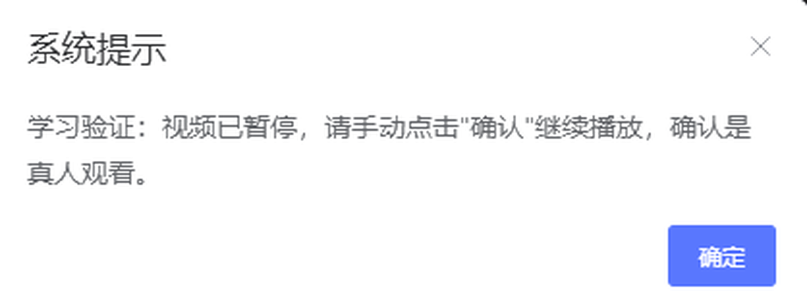

# 网校自动确认 · GZGS Auto Confirm

> 自动点掉广州工商学院网校（usc.gzgs.edu.cn）播放页的「学习验证」弹窗，点完自动恢复播放。
> 一个装一次、永久生效的 Edge / Chrome 浏览器扩展。

<p>
  
  
  
  
</p>

---

## 它解决什么问题

广工商网校的在线课程有一套「防刷课验证」机制：视频播到一半，平台会主动暂停并弹出一个框——



> **系统提示**
> 学习验证：视频已暂停，请手动点击"确认"继续播放，确认是真人观看。

每章每节都要点一次，不点就一直卡在那里，后面的自动连播也停了。一边做别的事一边刷课，基本等于被绑在电脑前。

这个扩展做的事很简单：**检测到这个框，等一两秒，替你点「确定」，再确认视频重新跑起来。**

---

## 装好之后长这样

页面右下角会出现一个小绿标：

```
✓ 自动确认 3
```

- 每自动点掉一次，数字 +1
- 点一下绿标 → 临时暂停；再点一下 → 恢复
- 只在网校域名下出现，不影响你其他任何网页

---

## 安装

> ⚠️ 本扩展尚未上架 Edge 加载项商店，因此需要走「开发者模式」安装。这是微软对所有第三方扩展的硬性要求，不是本项目偷懒。

### 方式一：一键安装脚本（推荐给同学）

1. 到 [Releases](../../releases) 页面下载最新的 `gzgs-auto-confirm-v1.0.0.zip`
2. **解压**到一个你不会随手删掉的位置
3. 双击解压出来的 **`一键安装.bat`**
4. 脚本会自动打开扩展管理页、并把路径复制到剪贴板，你只要：
   - 打开左下角「**开发人员模式**」
   - 点左上角「**加载解压缩的扩展**」
   - 在地址栏 `Ctrl+V` 粘贴路径，回车，点「选择文件夹」

### 方式二：完全手动（4 步）

1. 把 `extension` 文件夹放到一个固定位置，例如
   `C:\Users\你的用户名\Documents\Edge扩展\gzgs-auto-confirm`
2. 浏览器地址栏输入 `edge://extensions/` 回车
3. **左下角**打开「开发人员模式」
4. 左上角点「**加载解压缩的扩展**」→ 选中上一步的 `extension` 文件夹
5. 回到网校页面按 `F5` 刷新

> Chrome 用户把地址换成 `chrome://extensions/`，其余步骤完全一样。

---

## 功能

| 功能 | 说明 |
| --- | --- |
| 自动确认 | 识别「学习验证」弹窗并点击「确定」 |
| 拟人延迟 | 检测到弹窗后随机等 **1.2 ~ 3.6 秒**再点，避免因响应过快被判定为脚本 |
| 自动续播 | 点完确认后若视频未恢复，自动补一次 `play()` |
| 原生弹窗兜底 | 万一平台改用系统原生 `confirm()` / `alert()`，同样放行不阻塞 |
| 状态可见 | 右下角绿标实时显示已确认次数，可一键暂停 |
| 域名隔离 | 仅在 `usc.gzgs.edu.cn` 生效，不触碰任何其它网站 |

---

## 它是怎么找到弹窗的

平台的课程设置里有一组后端字段（在教师端配置）：

| 字段 | 含义 |
| --- | --- |
| `autoPause` | 防刷课验证 开关 |
| `autoPauseContent` | 防刷课提示语（教师可自定义） |
| `autoPlay` | 自动连播 |
| `switchPage` | 切页暂停 |

前端在播放器进度事件里判断后 `pause()` 并渲染弹窗。所以弹窗本质是一个 **DOM 元素**（Element UI 风格的消息框），可以用脚本安全地操作。

扩展的判定逻辑：不依赖固定 CSS 类名（平台改版就会失效），而是**以提示语文本为锚点**——

```
命中 "学习验证" / "视频已暂停" / "真人观看" 等关键词的可见浮层
        ↓
在该浮层内找文本为 确定 / 确认 / 继续 的按钮
        ↓
按"按钮相似度"排序，点最像按钮的那个
```

这套逻辑在平台改版、换 UI 框架的情况下依然大概率可用。

---

## 兼容性

| 浏览器 | 状态 |
| --- | --- |
| Microsoft Edge 136+ | ✅ 已验证（156.0.4314.50） |
| Google Chrome 136+ | ✅ 理论可用（改用 `chrome://extensions/`） |
| 其它 Chromium 内核浏览器 | ⚠️ 未测试 |

Manifest V3，无任何外部网络请求，不收集任何数据。

---

## 常见问题

**Q：右下角绿标没出现？**
A：先确认扩展在 `edge://extensions/` 里是启用状态，然后刷新网校页面。若还不行，按 `F12` 看 Console 里有没有 `[网校助手]` 开头的日志——有日志说明跑起来了，把报错发我。

**Q：绿标显示「⏸ 已暂停」？**
A：你点到它了。再点一下恢复。这是有意的设计——需要你自己动手看课的时候可以随时关掉。

**Q：会不会点错别的按钮？**
A：判定分两层：先要命中「学习验证」这类提示语所在的浮层，再在该浮层内部找按钮。不会去点页面上的普通按钮。

**Q：平台会不会检测到我用了脚本？**
A：扩展做了拟人延迟（1.2~3.6 秒随机），不是 0.1 秒秒点。但任何自动化都无法保证绝对不被识别，请自行评估风险。

**Q：为什么不做成真正的一键安装？**
A：Chromium 系浏览器规定，未上架官方商店的扩展只能通过开发者模式加载。想实现"点一下就好"，需要上架 Microsoft Edge 加载项商店（免费注册，但要过审核），在计划中。

---

## 隐私

- 不联网、不上传、不统计
- 不读取课表、成绩、账号密码
- 代码只有 3 个文件，总共不到 400 行，全部可审计

---

## 免责声明

本项目仅用于**减少重复机械操作**，不改变课程的实际播放进度，也不伪造学习时长。请确保你确实在学习，并自行承担使用风险。作者不对因使用本工具产生的任何后果负责。

---

## License

[MIT](LICENSE) © KSOWOVO
